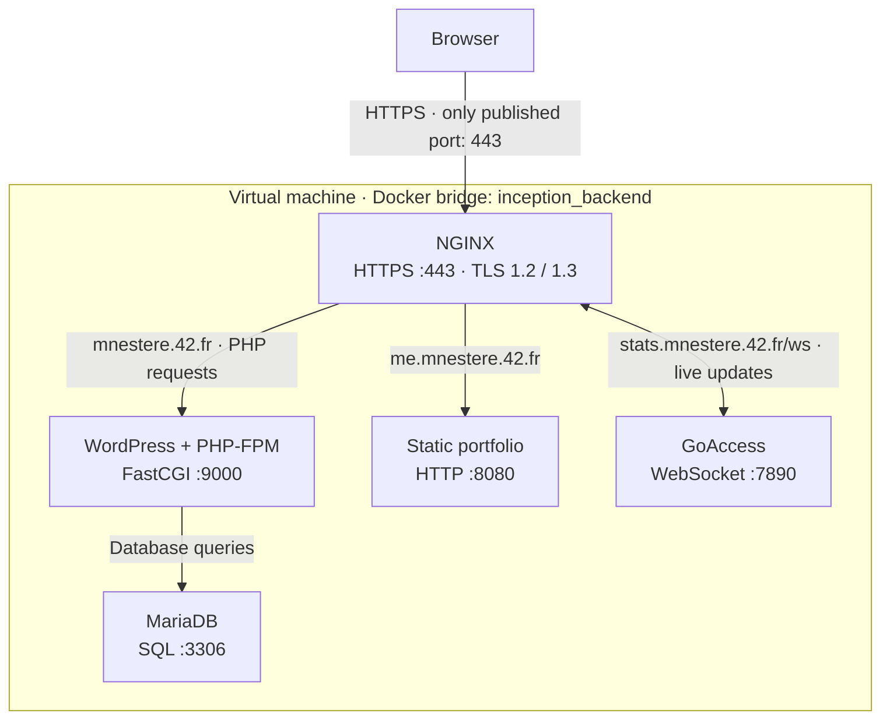

*This project has been created as part of the 42 curriculum by mnestere.*

# Inception

## Description

Inception is a 42 system administration project about building and operating a Docker infrastructure inside a virtual machine. It hosts a WordPress website behind HTTPS, with separate containers for the web server, PHP application and database. The project covers image builds, service networking, secrets and persistent storage.

The stack includes two bonuses: a static portfolio and a GoAccess traffic dashboard. Each of the five services has its own Dockerfile based on `debian:bookworm-slim`.

| Service | Role | Access |
|---|---|---|
| NGINX | Terminates TLS and routes requests to the websites | HTTPS on port 443 |
| WordPress + PHP-FPM | Runs WordPress and its administration panel | [Website](https://mnestere.42.fr) · [Administration](https://mnestere.42.fr/wp-admin/) |
| MariaDB | Stores WordPress content, settings and accounts | Internal database connection |
| Static website | Serves the HTML, CSS and JavaScript portfolio | [Portfolio](https://me.mnestere.42.fr) |
| GoAccess | Reports requests, response codes and traffic from NGINX logs | [Traffic dashboard](https://stats.mnestere.42.fr) |

## Instructions

Run the project inside a Linux VM with Docker Engine, Docker Compose V2, GNU Make and OpenSSL installed. Your account must be able to run Docker commands. The initial build requires internet access.

Configure Docker's `data-root` as `/home/mnestere/data/docker` before the first start; see [VM storage setup](DEV_DOC.md#docker-storage) for the steps. This places ordinary named volumes under the host directory required by the subject.

From the repository root, create the local configuration:

```sh
cp srcs/.env.example srcs/.env
```

Review `srcs/.env` before starting. It contains the domain, database and WordPress account names, and paths to password and certificate files. Keep an existing `.env` when updating the project.

For access inside the VM, add this line to `/etc/hosts` with administrative privileges:

```text
127.0.0.1 mnestere.42.fr me.mnestere.42.fr stats.mnestere.42.fr
```

For access from another machine, configure its hosts file with the VM's reachable IP address and ensure port 443 is reachable.

Build and start the stack:

```sh
make
make ps
```

`make` generates missing passwords and a self-signed TLS certificate, builds the images and starts the containers. Existing passwords and application data are preserved. Once WordPress finishes its first installation, open the URLs above and accept the self-signed certificate. WordPress login names are in `srcs/.env`; passwords are in the corresponding files under `secrets/`.

| Command | Effect |
|---|---|
| `make logs` | Follow the service logs |
| `make stop` / `make start` | Stop or resume existing containers |
| `make down` | Remove containers and the network; keep stored data |
| `make clean` | Also remove service images; keep stored data |
| `make fclean` / `make re` | Delete all stored application data; `re` then builds a fresh installation |

See [USER_DOC.md](USER_DOC.md) for daily operation and credentials, and [DEV_DOC.md](DEV_DOC.md) for configuration, rebuilds and troubleshooting.

## Architecture



NGINX publishes the stack's only host port and accepts TLS 1.2 and 1.3. It serves WordPress static files, sends PHP requests to PHP-FPM, and proxies portfolio requests to the static website container.

GoAccess reads the NGINX access log and writes an HTML report. NGINX serves that report on the statistics hostname and proxies its WebSocket connection for live updates. Requests to the dashboard are excluded from the access log.

Four ordinary named volumes retain data under `/home/mnestere/data/docker/volumes/<volume-name>/_data`:

| Volume (Compose prefix: `inception_`) | Contents | Access |
|---|---|---|
| `mariadb_data` | Database files | MariaDB reads and writes database files |
| `wordpress_data` | WordPress files | WordPress reads and writes; NGINX reads |
| `nginx_logs` | Access logs | NGINX writes; GoAccess reads |
| `goaccess_reports` | Traffic report | GoAccess writes; NGINX reads |

These files survive container recreation and `make down`. GoAccess rebuilds its report from the retained logs when it starts. Portfolio files are included in its image.

## Project description

Docker packages each service and its dependencies into a separate image. Compose defines how those containers share a network, storage and secrets; the Makefile prepares local files and runs Compose.

The repository contains:

- `srcs/requirements/`: service Dockerfiles, configuration files and startup scripts; bonus services are under `bonus/`.
- `srcs/scripts/entrypoint-lib.sh`: shared environment validation and secret-reading helpers.
- `srcs/docker-compose.yml`: service definitions, dependencies, network, volumes and secret mounts.
- `srcs/.env.example`: a template for the local configuration.
- `srcs/docker-daemon.json.example`: the VM's Docker storage setting.
- `Makefile`: build, startup, certificate generation and cleanup commands.

Startup scripts configure each service and use `exec` to run its daemon in the foreground. Compose provides process reaping through `init: true` and restarts containers with `restart: always`. WordPress starts after MariaDB passes an authenticated health check. Database initialization and WordPress installation run only when their persisted state is absent.

### Virtual Machines vs Docker

A VM runs its own guest kernel; containers share the host kernel and isolate application processes, filesystems and networking. Here, the VM provides the Linux host, and Docker separates the services within it.

### Secrets vs Environment Variables

Environment variables configure domains, account names and file paths. Passwords are read from files mounted only into the services that use them. This keeps password values out of the Compose environment, where they would be visible through container inspection. Local Compose secrets use files on the VM; those source files and `.env` are ignored by Git.

### Docker Network vs Host Network

A bridge network gives containers separate network interfaces and lets them resolve each other by service name. Host networking shares the host's network stack. This project uses the `inception_backend` bridge and publishes only NGINX port 443; application and database connections use internal service addresses.

### Docker Volumes vs Bind Mounts

Named volumes are created and managed by Docker and persist independently of containers. Bind mounts map an existing host directory into a container. The application volumes here use Docker's default local driver without bind options. Docker's `data-root` setting places their files under `/home/mnestere/data/docker`, rather than choosing host paths in Compose.

## Resources

- [Dockerfile reference](https://docs.docker.com/reference/dockerfile/) — image build instructions.
- [Docker daemon configuration](https://docs.docker.com/engine/daemon/) — the `data-root` storage setting.
- [Compose file reference](https://docs.docker.com/reference/compose-file/) — services, networks, volumes and secrets.
- [NGINX documentation](https://nginx.org/en/docs/) — TLS, FastCGI and reverse proxy configuration.
- [WP-CLI handbook](https://make.wordpress.org/cli/handbook/) — WordPress installation and account management.
- [MariaDB documentation](https://mariadb.com/kb/en/) — database initialization, accounts and permissions.
- [GoAccess manual](https://goaccess.io/man) — log formats and live HTML reports.

AI assistance: Codex helped review and update service configuration, shared entrypoint helpers, MariaDB bootstrap SQL and WordPress password handling. It also assisted with bonus-service integration, integration checks, and the README, user and developer documentation.
