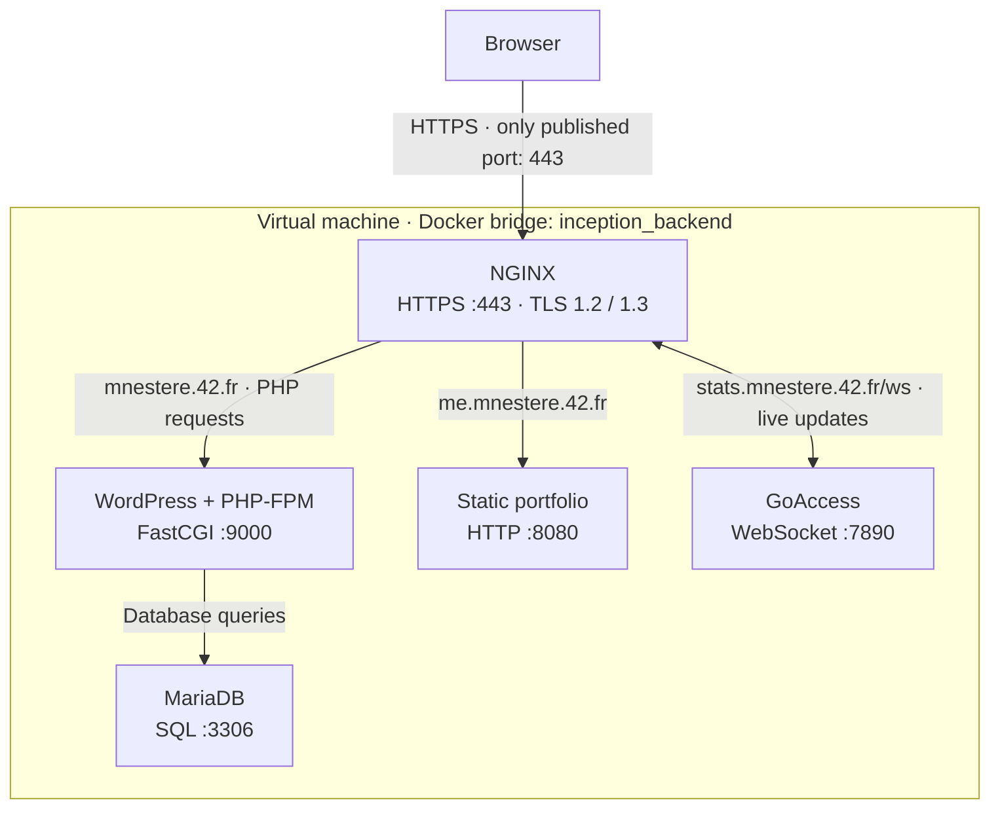
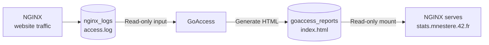

*This project has been created as part of the 42 curriculum by mnestere.*

# Inception

## Description

A small web infrastructure run with Docker Compose inside a virtual machine. Five containers, each built from its own Dockerfile on `debian:bookworm-slim`:

- **nginx**: the only entry point, HTTPS on port 443 (TLSv1.2/1.3 only).
- **wordpress**: WordPress with php-fpm (no web server inside).
- **mariadb**: the database (nothing else inside).
- **goaccess** (chosen-service bonus): live traffic statistics from NGINX access logs, served at `https://stats.mnestere.42.fr`.
- **static-website** (static-site bonus): a personal portfolio, served at `https://me.mnestere.42.fr`.

Four named volumes store the database, WordPress files, access logs and traffic reports under `/home/mnestere/data`. Passwords are Docker secrets, other settings come from `srcs/.env`.

## Architecture

NGINX routes all three hostnames. It serves WordPress's static files and the GoAccess report directly from read-only volume mounts, and forwards PHP requests and portfolio requests to their containers. Passwords and TLS files are mounted into their consuming containers as Compose secrets.

The traffic-report pipeline uses files shared through named volumes:

| Named volume | Host directory | Container access |
|---|---|---|
| `mariadb_data` | `/home/mnestere/data/mariadb` | MariaDB reads and writes database files |
| `wordpress_data` | `/home/mnestere/data/wordpress` | WordPress reads/writes; NGINX reads site files |
| `nginx_logs` | `/home/mnestere/data/nginx-logs` | NGINX writes access logs; GoAccess reads them |
| `goaccess_reports` | `/home/mnestere/data/goaccess` | GoAccess writes the report; NGINX serves it |

The portfolio files are included in its image and need no persistent volume. Statistics-page requests are excluded from the access log.

## Instructions

1. Add the domain to the hosts file: `127.0.0.1 mnestere.42.fr stats.mnestere.42.fr me.mnestere.42.fr` in `/etc/hosts`.
2. Copy `srcs/.env.example` to `srcs/.env` and adjust it.
3. Run `make`. It generates missing secrets and the TLS certificate, builds the images and starts the stack.
4. Open `https://mnestere.42.fr`, `https://me.mnestere.42.fr` or `https://stats.mnestere.42.fr` (accept the self-signed certificate).

Other targets: `make down`, `make stop`, `make start`, `make logs`, `make ps`, `make clean`, `make fclean`, `make re`. See `USER_DOC.md` and `DEV_DOC.md`.

## Project description

Docker is used to package each service with its dependencies into an image, and Compose describes how the containers, network, volumes and secrets fit together. Sources: one folder per service in `srcs/requirements/` (Dockerfile, config, entrypoint script), plus `srcs/docker-compose.yml` and the `Makefile`.

Main design choices: Debian base image, one process per container, `init: true` so PID 1 reaps zombies, entrypoint scripts that configure then `exec` the daemon in the foreground, MariaDB healthcheck so WordPress starts only when the database is ready.

### Virtual Machines vs Docker
A VM emulates a whole machine with its own kernel, so it is heavy and slow to start. A container shares the host kernel and isolates only processes and the filesystem, so it is light and starts in seconds. The VM here is the host that runs Docker.

### Secrets vs Environment Variables
Environment variables are visible via `docker inspect` and in the process environment, and are easy to leak into logs. Docker secrets are mounted as files in `/run/secrets` and only in the containers that need them. Here `.env` holds non-sensitive settings and file paths, passwords are secrets.

### Docker Network vs Host Network
On a Docker bridge network the containers get their own addresses, reach each other by service name, and only published ports are reachable from outside. With host networking the container shares the host's network stack, with no isolation. It is forbidden by the subject.

### Docker Volumes vs Bind Mounts
Named volumes are created and managed by Docker, with a lifecycle independent of the containers. A bind mount maps an arbitrary host path directly. The subject requires named volumes, so they are configured to store their data in `/home/mnestere/data`.

## Resources

- Docker docs: https://docs.docker.com/ (Compose file reference, secrets, volumes, networking)
- Dockerfile best practices: https://docs.docker.com/build/building/best-practices/
- NGINX docs: https://nginx.org/en/docs/
- WP-CLI handbook: https://make.wordpress.org/cli/handbook/
- GoAccess manual: https://goaccess.io/man
- MariaDB knowledge base: https://mariadb.com/kb/en/

AI use: Codex assisted with reviewing the VM and reference project, fixing argument handling and NGINX domain configuration, and improving build and cleanup behavior. AI also assisted with the GoAccess bonus integration, documentation updates and verification commands.

## Chosen-service bonus: GoAccess

GoAccess helps inspect website traffic and troubleshoot HTTP errors. Its image installs the Debian package on `debian:bookworm-slim`; there is no Node.js runtime. It runs in the foreground using its built-in live-report mode. NGINX serves the generated HTML and proxies the live WebSocket through HTTPS, with only port 443 published. The statistics host does not log its own requests.

Access logs and reports use named volumes stored at `/home/mnestere/data/nginx-logs` and `/home/mnestere/data/goaccess`. GoAccess mounts logs read-only; NGINX mounts reports read-only. Raw logs survive container recreation and are reprocessed at startup. GoAccess fulfills the service-of-your-choice item; the portfolio fulfills the static-site item. Redis, FTP and Adminer remain unimplemented.

## Static-site bonus: portfolio

The personal portfolio is built with HTML, CSS and JavaScript. Its dedicated Debian-based image installs NGINX and serves the static files directly. The main NGINX proxies `me.DOMAIN_NAME` to the container's internal port 8080. There is no PHP, Node.js or build step. Files are included in the image, so this service does not need a persistent volume.
